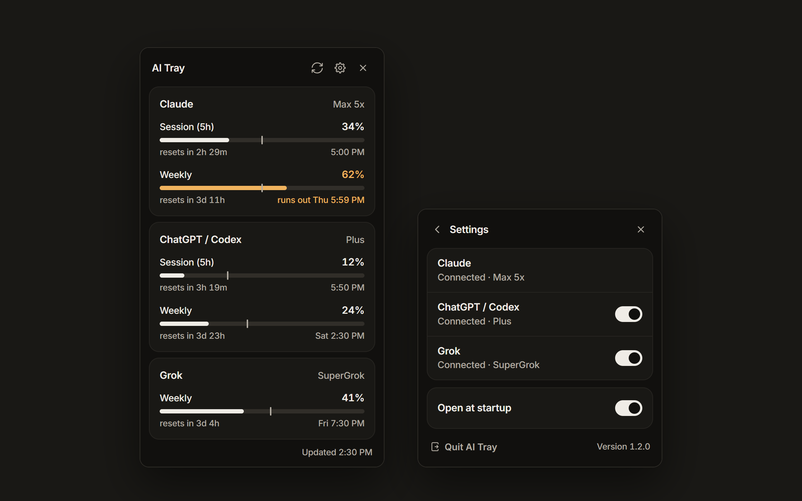

# AI Tray

A small Windows tray app that shows how much of your Claude, ChatGPT / Codex and Grok limits you've used, and whether you're on track to run out before they reset.



## What it shows

| Service | Limits |
| --- | --- |
| **Claude** (Pro / Max) | 5-hour session, weekly, and extra usage if you've turned it on |
| **ChatGPT / Codex** | 5-hour session and weekly |
| **Grok** (SuperGrok) | Weekly or monthly credits |

Bars are coloured by **pace**, not a fixed percentage. The small tick on each bar is where you'd be if you spread your usage evenly across the window.

- **Cream**: you'll finish under the limit at your current rate.
- **Amber**: you're heading for the limit before it resets. The reset time is replaced by when you'll run out.
- **Coral**: you're nearly out, or will run out well before the reset.

You also get a Windows notification when any limit passes 80%.

## Install

1. Download `AI Tray Setup <version>.exe` from the [Releases](../../releases) page and run it. It installs for your user only, no admin needed.
   Windows may warn that the app is from an unknown publisher, because it isn't code-signed. Choose **More info**, then **Run anyway**.
2. Sign in to the tools you use. AI Tray reads the login each one already saves on your PC, so there's nothing to paste in.
   - **Claude**: install [Claude Code](https://docs.anthropic.com/en/docs/claude-code) and sign in once with `claude`.
   - **ChatGPT / Codex**: install the [Codex CLI](https://github.com/openai/codex) and run `codex login`.
   - **Grok**: install the Grok CLI and run `grok login --oauth`.
3. Click the AI Tray icon near the clock. ChatGPT and Grok can be switched off in Settings if you don't use them.

## Build from source

You need Windows and [Node.js](https://nodejs.org) 22.12 or newer.

```
npm install
npm start          # run it from the source folder
npm run build      # make dist\AI Tray Setup <version>.exe
```

A copy started with `npm start` keeps its settings in `%APPDATA%\ai-tray-dev`, so it never interferes with an installed copy.

## How it works

Everything runs on your PC. There's no server, no account and no analytics.

| Service | Login it reads | Where it asks |
| --- | --- | --- |
| Claude | `~\.claude\.credentials.json` (Claude Code) | `api.anthropic.com`, and `platform.claude.com` to renew an expired login |
| ChatGPT / Codex | `~\.codex\auth.json` (Codex CLI) | `chatgpt.com` |
| Grok | `~\.grok\auth.json` (Grok CLI) | `cli-chat-proxy.grok.com`, and `auth.x.ai` to renew its 6-hour login |

Good to know:

- When a Claude or Grok login has expired, AI Tray renews it and saves the new one back to that tool's login file, so the CLI keeps working too. It won't overwrite a Claude login that Claude Code renewed in the meantime. ChatGPT logins are only read, never changed; open Codex every week or so to keep it signed in.
- AI Tray keeps a few small files in `%APPDATA%\ai-tray`: your settings, the last numbers it fetched (so it can show them straight away after a restart), and `ai-tray.log`, a short record of each refresh that's useful if you report a bug. The log never contains logins or tokens, and your Windows user folder shows as `~`.
- If you've pointed the Codex CLI at another ChatGPT address (`chatgpt_base_url` in `~.codexconfig.toml`) or the Grok CLI at another sign-in server, AI Tray follows that setting, as the CLIs do.
- It uses the same usage endpoints the official tools use. They aren't public APIs and could change without notice.

AI Tray isn't affiliated with or endorsed by Anthropic, OpenAI or xAI. It uses the logins those tools already store on your PC; use it at your own risk.

## Credits

Reading ChatGPT and Grok usage is ported from [Win-CodexBar](https://github.com/nesszer/Win-CodexBar), the Windows port of [CodexBar](https://github.com/steipete/CodexBar) by Peter Steinberger. The interface uses the [Inter](https://rsms.me/inter/) typeface. Their licences are in [THIRD_PARTY_NOTICES.md](THIRD_PARTY_NOTICES.md).

## Licence

[MIT](LICENSE)
