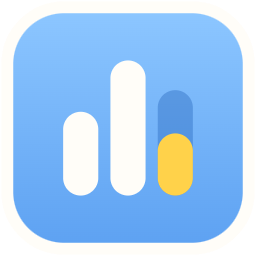
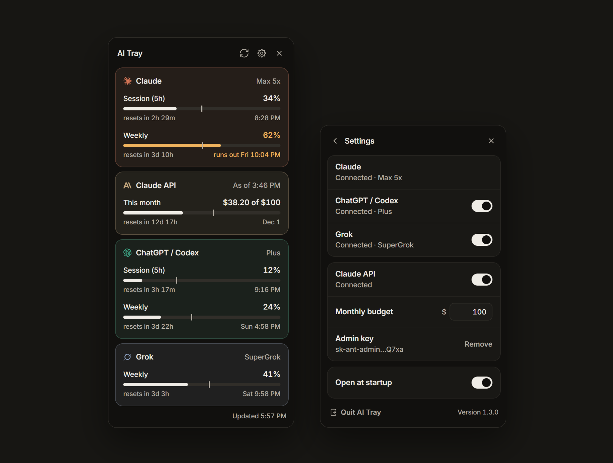

# AI Tray

A small Windows tray app that shows how much of your Claude, ChatGPT / Codex and Grok limits you've used, and whether you're on track to run out before they reset. It can also show your Claude API spend for the month.

It stands on the work of [CodexBar](https://github.com/steipete/CodexBar) and its Windows port [Win-CodexBar](https://github.com/nesszer/Win-CodexBar); see [Credits](#credits). For a Mac version, or many more services, use those.



## What it shows

| Service | Limits |
| --- | --- |
| **Claude** (Pro / Max) | 5-hour session, weekly, and extra usage if you've turned it on |
| **Claude API** (optional) | Spend this month against a budget you set ($100 to start) |
| **ChatGPT / Codex** | 5-hour session and weekly |
| **Grok** (SuperGrok) | Weekly or monthly credits |

Bars are coloured by **pace**, not a fixed percentage. The small tick on each bar is where you'd be if you spread your usage evenly across the window.

- **Cream**: you'll finish under the limit at your current rate.
- **Amber**: you're heading for the limit before it resets. The reset time is replaced by when you'll run out.
- **Coral**: you're nearly out, or will run out well before the reset.

You also get a Windows notification when any limit passes 80%.

## Install

1. Download `AI.Tray.Setup.<version>.exe` from the [latest release](https://github.com/mooneydavid/ai-tray/releases/latest) and run it. It installs for your user only, no admin needed.
   Windows may warn that the app is from an unknown publisher, because it isn't code-signed. Choose **More info**, then **Run anyway**.
2. Sign in to the tools you use. AI Tray reads the login each one already saves on your PC, so there's nothing to paste in.
   - **Claude**: install [Claude Code](https://docs.anthropic.com/en/docs/claude-code) and sign in once with `claude`.
   - **ChatGPT / Codex**: install the [Codex CLI](https://github.com/openai/codex) and run `codex login`.
   - **Grok**: install the Grok CLI and run `grok login --oauth`.
3. Click the AI Tray icon near the clock. ChatGPT and Grok can be switched off in Settings if you don't use them.

### Claude API spend (optional)

Anthropic only shares API spend with an **admin key**, which is different from a normal API key.

1. Admin keys need a team organization in the [Claude Console](https://platform.claude.com). If yours says "Individual Org", use **Convert to team** on the [Organization page](https://platform.claude.com/settings/organization). You can stay the only member.
2. On the [Admin keys page](https://platform.claude.com/settings/admin-keys), click **Create admin key** and copy it. It starts with `sk-ant-admin01-` and is shown only once.
3. In AI Tray, open Settings, paste it under **Claude API** and click **Save**. AI Tray checks it with Anthropic before saving it.

Anthropic updates spend a few hours behind, so the card says how current its numbers are ("As of 3:46 PM"). There's no API for remaining credit, so the card shows spend against a monthly budget you can change in Settings.

## Build from source

You need Windows and [Node.js](https://nodejs.org) 22.12 or newer.

```
npm install
npm start          # run it from the source folder
npm run build      # make dist\AI Tray Setup <version>.exe
```

A copy started with `npm start` keeps its settings in `%APPDATA%\ai-tray-dev`, so it never interferes with an installed copy.

## How it works

Everything runs on your PC. There's no server, no account and no analytics.

| Service | Login it reads | Where it asks |
| --- | --- | --- |
| Claude | `~\.claude\.credentials.json` (Claude Code) | `api.anthropic.com` |
| ChatGPT / Codex | `~\.codex\auth.json` (Codex CLI) | `chatgpt.com` |
| Grok | `~\.grok\auth.json` (Grok CLI) | `cli-chat-proxy.grok.com`, and `auth.x.ai` to renew its 6-hour login |
| Claude API | The admin key you paste into Settings | `api.anthropic.com`, for its cost report only |

Good to know:

- AI Tray never changes your Claude login. When it runs out, AI Tray starts Claude Code for a moment (`claude -p` with nothing to ask) and Claude Code renews its own login. Nothing is sent to Claude, so it uses none of your usage.
- Grok's login lasts 6 hours, so AI Tray renews it itself and saves it back to `~\.grok\auth.json`, so the Grok CLI keeps working too. It never overwrites a login the Grok CLI saved in the meantime.
- ChatGPT logins are only read, never changed. Open Codex every week or so to keep it signed in.
- An admin key could manage your whole Console organization, and Anthropic doesn't offer a read-only one. So AI Tray locks itself to a single request with it: reading the cost report from `api.anthropic.com`. Anything else is refused inside the app. The key is encrypted with Windows' own per-user encryption, saved in a file only your Windows account can open, and never shown in full or logged. To cut it off, delete it on the Console's Admin keys page, or click **Remove** in Settings.
- AI Tray keeps a few small files in `%APPDATA%\ai-tray`: your settings, the encrypted admin key if you added one, the last numbers it fetched (so it can show them straight away after a restart), and `ai-tray.log`, a short record of each refresh that's useful if you report a bug. The log never contains logins or tokens, and your Windows user folder shows as `~`.
- If you've pointed the Codex CLI at another ChatGPT address (`chatgpt_base_url` in `~\.codex\config.toml`) or the Grok CLI at another sign-in server, AI Tray follows that setting, as the CLIs do.
- It uses the same usage endpoints the official tools use. They aren't public APIs and could change without notice.

AI Tray isn't affiliated with or endorsed by Anthropic, OpenAI or xAI. It uses the logins those tools already store on your PC; use it at your own risk. The service logos on the cards belong to their owners and are only there to show which service each card is for.

## Credits

AI Tray wouldn't exist without [CodexBar](https://github.com/steipete/CodexBar) by Peter Steinberger and [Win-CodexBar](https://github.com/nesszer/Win-CodexBar), its Windows port.

- Reading ChatGPT and Grok usage is ported from Win-CodexBar.
- Reading Claude usage with Claude Code's login, and letting Claude Code renew that login itself, follow CodexBar's approach.

What AI Tray adds is its own interface, the pace colouring, and a simpler tray app built just for these three services.

The interface uses the [Inter](https://rsms.me/inter/) typeface, logos from [Simple Icons](https://simpleicons.org) and [LobeHub Icons](https://github.com/lobehub/lobe-icons), and the Claude API card reads spend with Anthropic's [TypeScript SDK](https://github.com/anthropics/anthropic-sdk-typescript). Licences for all of these are in [THIRD_PARTY_NOTICES.md](THIRD_PARTY_NOTICES.md).

## Licence

[MIT](LICENSE)
